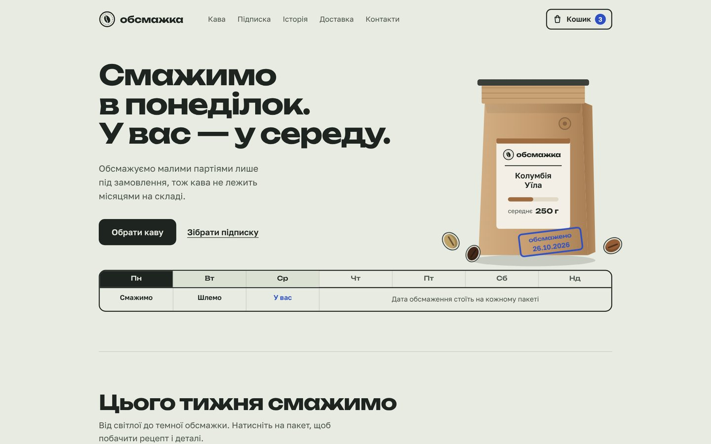

# Обсмажка

Концепт-проєкт: айдентика, лендинг та інтернет-магазин для кавової обсмажувальні.

## Відкрити сайт

- **[Інтернет-магазин](https://zinchenkoanton11.github.io/obsmazhka/shop/)** — каталог, картки сортів, кошик, оформлення, панель замовлень
- **[Лендинг](https://zinchenkoanton11.github.io/obsmazhka/landing/)** — одна сторінка з конструктором підписки
- **[Кейс](https://zinchenkoanton11.github.io/obsmazhka/)** — задача, ідея, айдентика, рішення й етапи роботи

## Що всередині

- `index.html` — сторінка-кейс
- `landing/` — лендинг
- `shop/` — інтернет-магазин
- `img/` — скриншоти для кейсу

HTML, CSS і JavaScript без фреймворків. Бренд, адреси й телефони вигадані.
